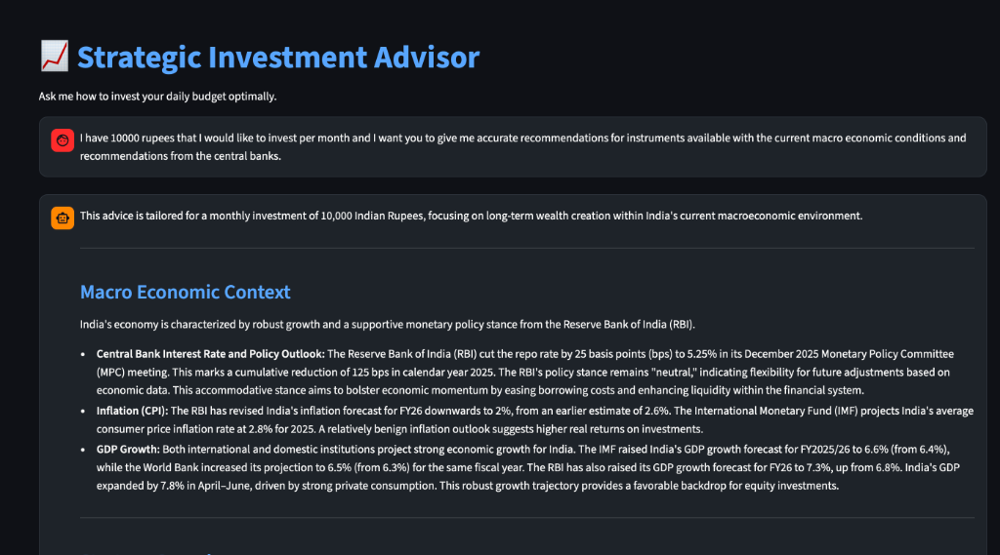
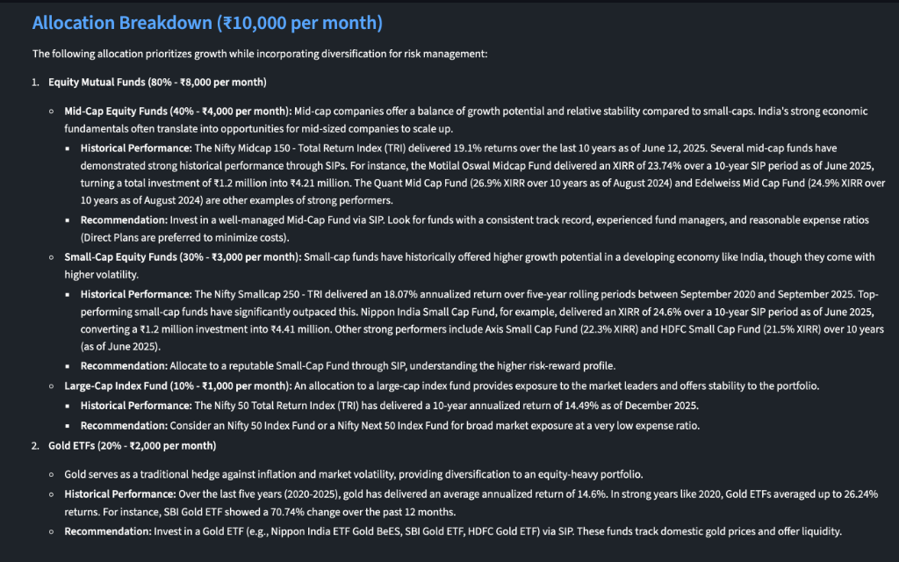

# 💰 Safe Investment Researcher & Advisor Bot

A professional, AI-powered investment advisor designed to provide **safe, strategic, and actionable financial advice** for daily micro-investors ($10 - $50/day). 

Built with **Streamlit** and **Google's Gemini 2.5 AI**, this application offers real-time market grounding, country-specific localization, and free-tier optimized performance.

### 📸 Project Screenshots

**1. Real-Time Macro Economic Context (Search Grounding)**


**2. Strategic Allocation & Historical Performance**


## 🌟 Key Features

### 🌍 Global Localization
- **Country-Specific Advice**: Tailors recommendations based on your selected region (e.g., **401k/IRA** for US, **ISA** for UK, **TFSA** for Canada).
- **Local Assets**: Suggests tickers and platforms available in your jurisdiction (e.g., VOO vs VUSA).

### 🧠 Real-Time Search Grounding
- **No Hallucinations**: Strictly forbids simulation. Uses **Google Search** to fetch *live* data.
- **Macro Analysis**: Analyzes current **Central Bank** minutes (Fed, ECB, BOE) and **Inflation (CPI)** reports to justify advice.
- **Verification**: Cross-references budget constraints with actual platform fees.

### ⚡️ Free Tier Optimized
- **Model Selector**: Choose between **Gemini 2.5 Flash** (Balanced) and **Flash-Lite** (Fastest/Cheapest).
- **Smart Rate Limiting**: Intelligent retry logic (via `tenacity`) handles API quotas gracefully, preventing crashes on "Resource Exhausted" errors.

### 🎨 Premium Experience
- **Rich Aesthetics**: Dark-mode UI with glassmorphism effects and responsiveness.
- **Downloadable Reports**: Export your strategic investment plan as a Markdown report.

---

## 🚀 Quick Start

### Prerequisites
- Python 3.10+
- A [Google AI Studio API Key](https://aistudio.google.com/)

### Installation

1.  **Clone the repository**:
    ```bash
    git clone https://github.com/ananddw24/safe_investment_researcher.git
    cd safe_investment_researcher
    ```

2.  **Run the automated setup script**:
    ```bash
    ./start.sh
    ```
    *This script creates a virtual environment, installs dependencies, and launches the app.*

3.  **Access the App**:
    Open your browser to `http://localhost:8505`

---

## 🛠️ Technology Stack

- **Frontend/Backend**: [Streamlit](https://streamlit.io/) (Python)
- **AI Model**: Google Gemini 2.5 Flash / Flash-Lite via `google-genai` SDK
- **Reliability**: `tenacity` for retry logic
- **Search**: Google Search Tool (Grounding)

## 📂 Project Structure

```
.
├── advisor_agent.py    # Core AI Logic (Prompting, Search Integration, Retries)
├── app.py              # Streamlit UI & State Management
├── styles.css          # Custom CSS for Premium Look
├── start.sh            # One-click startup script
├── requirements.txt    # Python dependencies
└── docs/               # Development artifacts and plans
```

## 📝 Documentation
Detailed development logs and plans are available in the `docs/` directory:
- [Implementation Plan](docs/implementation_plan.md)
- [Walkthrough & Verification](docs/walkthrough.md)
- [Task Log](docs/task.md)

---

**Disclaimer**: *This tool provides information for educational purposes only and does not constitute financial advice. Always consult with a qualified financial professional before making investment decisions.*
