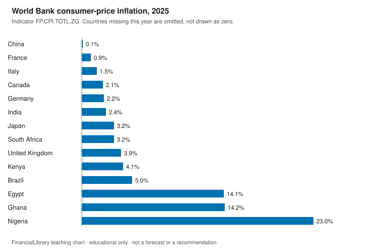
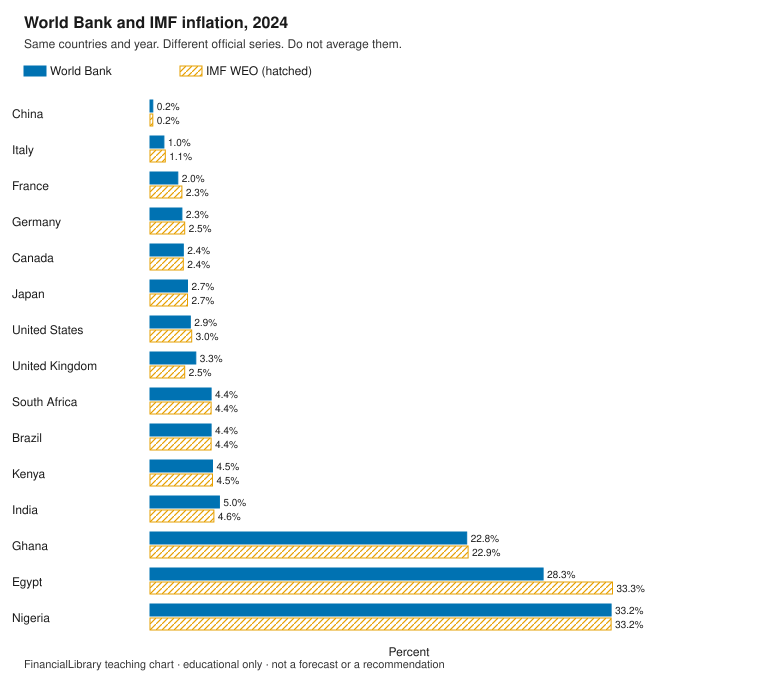

# Cross-country inflation

!!! warning "Educational only"
    This page is for financial literacy. It is **not** personalized advice,
    an offer to sell, or a recommendation to buy, sell, or hold any product.
    Rules differ by country; verify with official sources in your jurisdiction.

Two official compilers publish annual inflation for the same countries. The numbers do not have
to match. This module puts them side by side for the countries in this library. It does not rank
places to put money, and it does not average the two sources into a single true rate.

## Learning objectives

1. Read an annual inflation bar as one official series for one year, with the year attached.
2. Treat a missing country as a gap, not as zero.
3. Label IMF values for years after the last complete calendar year as WEO projections.

## The picture

{.teaching-figure}

Caption: World Bank indicator `FP.CPI.TOTL.ZG` for 2025, the last complete calendar year on
2026-10-30. Countries with no 2025 value in this snapshot: United States. They are omitted. They
are not zero.

PNG of the same chart: [download](figures/cross-country-wb-inflation.png).

{.teaching-figure}

Caption: Solid bars are the World Bank. Hatched bars are IMF DataMapper `PCPIPCH` for 2024, the
latest year in this snapshot where every library country has both. The series measure related
prices differently. A gap between bars is not a data-entry error by itself.

PNG of the same chart: [download](figures/cross-country-wb-imf.png).

## Explainer

The World Bank indicator name in the snapshot is: Inflation, consumer prices (annual %). The IMF
metadata in the snapshot calls `PCPIPCH` "Inflation rate, average consumer prices" (Annual
percent change), source "World Economic Outlook (October 2026)".

On the 2025 World Bank chart, the highest value among the countries that have a number is
Nigeria, 23.0 percent. The United States' latest World Bank observation in this pull is 2024:
2.9 percent.

The snapshot metadata names the source as "World Economic Outlook (October 2026)". For these
countries the series runs through 2031. History charts stop at 2025, the last calendar year that
had ended on 2026-10-30. Later years are in the table below and are labeled WEO projections:
they are the vintage's published values for years that were not finished on the retrieval date,
not measured inflation.

For Nigeria in 2024, the World Bank value is 33.2 percent and the IMF value is 33.2 percent. Use
the comparison chart and the table for every country. Do not average the pair.

## WEO projections

IMF `PCPIPCH` for 2026 through 2031, from the source named in the snapshot metadata ("World
Economic Outlook (October 2026)"). Each of these years is a WEO projection in this module. They
are not plotted on the history charts. Values are rounded half up to one decimal.

| Country | ISO3 | 2026 | 2027 | 2028 | 2029 | 2030 | 2031 |
| --- | --- | --- | --- | --- | --- | --- | --- |
| Brazil | BRA | 4.4 | 4.1 | 3.1 | 3.0 | 3.0 | 3.0 |
| Canada | CAN | 2.8 | 2.4 | 2.0 | 2.0 | 2.0 | 2.0 |
| China | CHN | 1.0 | 1.4 | 1.6 | 1.9 | 2.0 | 2.0 |
| Egypt | EGY | 13.3 | 14.8 | 8.9 | 6.5 | 5.8 | 5.4 |
| France | FRA | 2.4 | 2.2 | 1.9 | 1.9 | 1.9 | 1.8 |
| Germany | DEU | 2.7 | 3.1 | 2.0 | 2.1 | 2.1 | 2.1 |
| Ghana | GHA | 4.8 | 7.8 | 8.0 | 8.0 | 8.0 | 8.0 |
| India | IND | 5.0 | 4.4 | 3.9 | 4.0 | 4.0 | 4.0 |
| Italy | ITA | 3.3 | 2.8 | 2.3 | 2.0 | 2.0 | 2.0 |
| Japan | JPN | 2.0 | 2.6 | 2.0 | 2.0 | 2.0 | 2.0 |
| Kenya | KEN | 6.0 | 5.0 | 5.3 | 5.2 | 5.0 | 5.0 |
| Nigeria | NGA | 15.6 | 14.7 | 13.3 | 11.5 | 10.5 | 10.0 |
| South Africa | ZAF | 4.4 | 3.9 | 3.3 | 3.0 | 3.0 | 3.0 |
| United Kingdom | GBR | 3.3 | 2.8 | 2.0 | 2.0 | 2.0 | 2.0 |
| United States | USA | 3.6 | 2.8 | 2.1 | 1.9 | 1.9 | 1.9 |

## Discussion questions

1. Pick a country where the two bars differ. What are two reasons official inflation measures
   can differ without either number being a typo?
2. A country is missing from the latest-year chart. What should you do instead of treating the
   gap as zero?
3. How should a class label an IMF cell for a year that was not finished on the retrieval date?

## Exercise

On the 2025 World Bank chart, which plotted country is highest, and what is that value to one
decimal place? If a library country is missing, name it and do not treat it as zero.

## Answer key

Discussion questions stay open. This key answers the exercise only.

<details markdown="1">
<summary>Show the answer key</summary>

The highest plotted World Bank value for 2025 is Nigeria (`NGA`), 23.0 percent
(`FP.CPI.TOTL.ZG`, rounded half up to one decimal). Missing in 2025: United States. A higher
inflation reading is not a verdict on a country and not a product suggestion.

</details>

## Sources and citations

Retrieved 2026-10-30. World Bank indicator page and IMF DataMapper page are linked below. The
exact API requests are in the manifest and in the code block.

| Publisher | ID | What the snapshot calls it | Page |
| --- | --- | --- | --- |
| World Bank | FP.CPI.TOTL.ZG | Inflation, consumer prices (annual %) | [Indicator](https://data.worldbank.org/indicator/FP.CPI.TOTL.ZG) |
| IMF DataMapper | PCPIPCH | Inflation rate, average consumer prices; World Economic Outlook (October 2026) | [DataMapper](https://www.imf.org/external/datamapper/PCPIPCH) |

World Bank 2025 values, rounded half up to one decimal:

| Country | ISO3 | Year | Value |
| --- | --- | --- | --- |
| Brazil | BRA | 2025 | 5.0 |
| Canada | CAN | 2025 | 2.1 |
| China | CHN | 2025 | 0.1 |
| Egypt | EGY | 2025 | 14.1 |
| France | FRA | 2025 | 0.9 |
| Germany | DEU | 2025 | 2.2 |
| Ghana | GHA | 2025 | 14.2 |
| India | IND | 2025 | 2.4 |
| Italy | ITA | 2025 | 1.5 |
| Japan | JPN | 2025 | 3.2 |
| Kenya | KEN | 2025 | 4.1 |
| Nigeria | NGA | 2025 | 23.0 |
| South Africa | ZAF | 2025 | 3.2 |
| United Kingdom | GBR | 2025 | 3.9 |

Comparison year 2024, both series rounded half up to one decimal:

| Country | ISO3 | World Bank | IMF PCPIPCH |
| --- | --- | --- | --- |
| Brazil | BRA | 4.4 | 4.4 |
| Canada | CAN | 2.4 | 2.4 |
| China | CHN | 0.2 | 0.2 |
| Egypt | EGY | 28.3 | 33.3 |
| France | FRA | 2.0 | 2.3 |
| Germany | DEU | 2.3 | 2.5 |
| Ghana | GHA | 22.8 | 22.9 |
| India | IND | 5.0 | 4.6 |
| Italy | ITA | 1.0 | 1.1 |
| Japan | JPN | 2.7 | 2.7 |
| Kenya | KEN | 4.5 | 4.5 |
| Nigeria | NGA | 33.2 | 33.2 |
| South Africa | ZAF | 4.4 | 4.4 |
| United Kingdom | GBR | 3.3 | 2.5 |
| United States | USA | 2.9 | 3.0 |

```text
https://api.worldbank.org/v2/country/BRA;CAN;CHN;DEU;EGY;FRA;GBR;GHA;IND;ITA;JPN;KEN;NGA;USA;ZAF/indicator/FP.CPI.TOTL.ZG?format=json&per_page=2000&page=1
https://www.imf.org/external/datamapper/api/v1/PCPIPCH
https://www.imf.org/external/datamapper/api/v1/indicators
```

## Related

- [Teaching portfolio](index.md)
- [Inflation and capital preservation](../inflation-capital-preservation.md)
- [Where to check official figures](../../about/where-to-check.md)
- [Household finance](household-finance.md)
