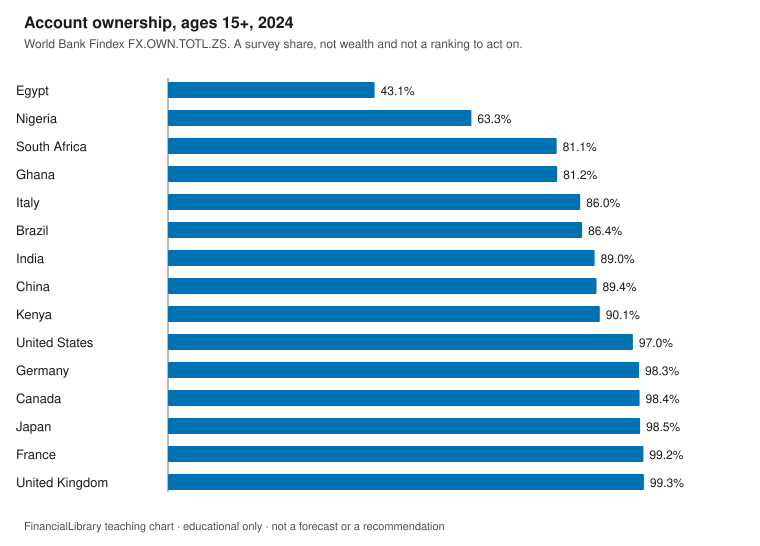
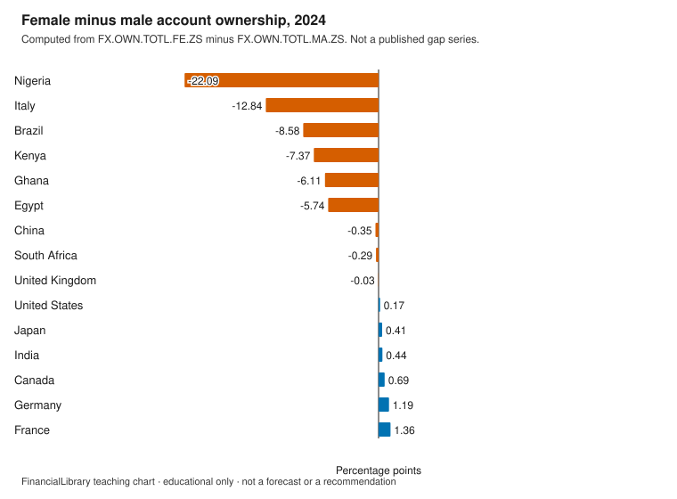

# Household finance and financial inclusion

!!! warning "Educational only"
    This page is for financial literacy. It is **not** personalized advice,
    an offer to sell, or a recommendation to buy, sell, or hold any product.
    Rules differ by country; verify with official sources in your jurisdiction.

Account ownership is a survey share: how many adults said they have an account at a financial
institution or with a mobile-money provider. This module reads that share for the library's
countries, and the female-minus-male difference computed from the two published sex splits. It
is not wealth, not control of the account, and not a ranking of where to bank.

## Learning objectives

1. Read an account-ownership percent as a share of adults ages 15+ in a survey year.
2. Compute a female-minus-male gap from the two official series and state the sign.
3. Name what the share does not measure: balances, fees, or who controls the account.

## The picture

{.teaching-figure}

Caption: World Bank `FX.OWN.TOTL.ZS` for 2024, the latest survey year in this snapshot present
for every library country. Sorted from lower to higher. The number is a survey share.

PNG of the same chart: [download](figures/inclusion-account-ownership.png).

{.teaching-figure}

Caption: Female share minus male share in 2024, in percentage points. Computed in this library
from `FX.OWN.TOTL.FE.ZS` and `FX.OWN.TOTL.MA.ZS`. It is not a separate published series. A
negative bar means the reported female share is lower.

PNG of the same chart: [download](figures/inclusion-gender-gap.png).

## Explainer

The World Bank name for the total series is: Account ownership at a financial institution or
with a mobile-money-service provider (% of population ages 15+).

The female series is named: Account ownership at a financial institution or with a
mobile-money-service provider, female (% of population ages 15+).

The male series is named: Account ownership at a financial institution or with a
mobile-money-service provider, male (% of population ages 15+).

In 2024, the lowest total share among these countries is Egypt at 43.1 percent. The most
negative female-minus-male gap is Nigeria at -22.09 percentage points (female 52.22 minus male
74.30). That gap is negative: the reported female share is lower.

Findex years in this snapshot are survey years, not every calendar year. A higher share means
more adults reported an account. It does not say the account is free of fees, that the balance
is large, or that the person who answered controls the money. The
[woman-led household pathway](../../pathways/woman-led-household.md) is about access and
control; this chart can speak to reported access by sex, and it cannot see control inside a
household.

## Discussion questions

1. Account ownership is a share of adults. What does a high share not tell you about balances,
   fees, or control?
2. A positive female-minus-male gap and a negative one mean different things. State both in
   words.
3. Which part of access versus control can this chart speak to, and which part can it not?

## Exercise

For 2024, name the library country with the lowest account-ownership share and the country with
the most negative female-minus-male gap. Give the ownership share to one decimal place and the
gap to two decimal places. Say whether that gap is positive or negative.

## Answer key

Discussion questions stay open. This key answers the exercise only.

<details markdown="1">
<summary>Show the answer key</summary>

Lowest account ownership in 2024 is Egypt (`EGY`), 43.1 percent (`FX.OWN.TOTL.ZS`). The most
negative gap is Nigeria (`NGA`): female 52.22 minus male 74.30 is -22.09 percentage points. The
result is negative. The gap is computed in this library. It is not a published series and not a
recommendation.

</details>

## Sources and citations

Retrieved 2026-10-30. Survey year used: 2024.

| Series | ID | Official name in the snapshot |
| --- | --- | --- |
| Account ownership, total | FX.OWN.TOTL.ZS | Account ownership at a financial institution or with a mobile-money-service provider (% of population ages 15+) |
| Account ownership, female | FX.OWN.TOTL.FE.ZS | Account ownership at a financial institution or with a mobile-money-service provider, female (% of population ages 15+) |
| Account ownership, male | FX.OWN.TOTL.MA.ZS | Account ownership at a financial institution or with a mobile-money-service provider, male (% of population ages 15+) |

| Country | ISO3 | Total | Female | Male | Female minus male |
| --- | --- | --- | --- | --- | --- |
| Brazil | BRA | 86.4 | 82.28 | 90.85 | -8.58 |
| Canada | CAN | 98.4 | 98.75 | 98.06 | 0.69 |
| China | CHN | 89.4 | 89.20 | 89.56 | -0.35 |
| Egypt | EGY | 43.1 | 40.21 | 45.95 | -5.74 |
| France | FRA | 99.2 | 99.85 | 98.49 | 1.36 |
| Germany | DEU | 98.3 | 98.87 | 97.68 | 1.19 |
| Ghana | GHA | 81.2 | 78.31 | 84.42 | -6.11 |
| India | IND | 89.0 | 89.25 | 88.81 | 0.44 |
| Italy | ITA | 86.0 | 79.79 | 92.63 | -12.84 |
| Japan | JPN | 98.5 | 98.72 | 98.31 | 0.41 |
| Kenya | KEN | 90.1 | 86.52 | 93.89 | -7.37 |
| Nigeria | NGA | 63.3 | 52.22 | 74.30 | -22.09 |
| South Africa | ZAF | 81.1 | 80.99 | 81.28 | -0.29 |
| United Kingdom | GBR | 99.3 | 99.27 | 99.30 | -0.03 |
| United States | USA | 97.0 | 97.11 | 96.94 | 0.17 |

```text
https://api.worldbank.org/v2/country/BRA;CAN;CHN;DEU;EGY;FRA;GBR;GHA;IND;ITA;JPN;KEN;NGA;USA;ZAF/indicator/FX.OWN.TOTL.ZS?format=json&per_page=2000&page=1
https://api.worldbank.org/v2/country/BRA;CAN;CHN;DEU;EGY;FRA;GBR;GHA;IND;ITA;JPN;KEN;NGA;USA;ZAF/indicator/FX.OWN.TOTL.FE.ZS?format=json&per_page=2000&page=1
https://api.worldbank.org/v2/country/BRA;CAN;CHN;DEU;EGY;FRA;GBR;GHA;IND;ITA;JPN;KEN;NGA;USA;ZAF/indicator/FX.OWN.TOTL.MA.ZS?format=json&per_page=2000&page=1
https://www.worldbank.org/en/publication/globalfindex
```

## Related

- [Teaching portfolio](index.md)
- [Woman-led household pathway](../../pathways/woman-led-household.md)
- [Emergency savings](../emergency-savings.md)
- [Glossary: deposit insurance](../../glossary.md#deposit-insurance)
