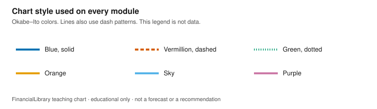

# Teaching portfolio

!!! warning "Educational only"
    This page is for financial literacy. It is **not** personalized advice,
    an offer to sell, or a recommendation to buy, sell, or hold any product.
    Rules differ by country; verify with official sources in your jurisdiction.

Six short modules for educators and learners. Each one has learning objectives, charts drawn
from a checked-in official snapshot, an explainer, discussion questions, an exercise, an answer
key, and a sources block with series IDs and the retrieval date. Nothing here is a
recommendation to buy, sell, or hold a product.

These modules do not use hypothetical numbers. Where a line is calculated from official inputs,
the caption says it is computed in this library and is not a separate published series.

## How the figures were made

Retrieved 2026-10-30. Charts use observations from 2016-10-01 through 2026-10-30, and they
ignore any later row. Regenerate the pages and figures from the snapshots with the command
below. `--fetch` downloads fresh snapshots and needs a network; the default command does not. No
API key is required. SEC EDGAR is asked for a User-Agent, and this script sends the same contact
string already used by the educator reports.

```bash
python3 scripts/generate_teaching_portfolio.py
python3 scripts/generate_teaching_portfolio.py --check
```

FRED, World Bank, and IMF files under `data/teaching/snapshots/` are trimmed to the years these
modules use. The manifest records the original request URL, the retrieval date, and the SHA-256
of the trimmed file. The EDGAR companyfacts and submissions documents are large, so the snapshot
keeps the facts and filing fields this portfolio uses, copied unchanged, plus the SHA-256 of
each full payload in `manifest.json`.

{.teaching-figure}

Caption: A style sample, not a data series. The same colors and dash patterns are used on every
module. Numbers are also printed on the charts.

PNG of the same chart: [download](figures/chart-style.png).

## Modules

| Module | Official sources | A latest reading in this snapshot |
| --- | --- | --- |
| [Rates and inflation](rates-and-inflation.md) | FRED `FEDFUNDS`, `CPIAUCSL` | 3.75% on 2026-09-01 |
| [Yield curve](yield-curve.md) | FRED `DGS3MO`, `DGS2`, `DGS5`, `DGS10`, `DGS30` | 10-year minus 2-year 0.37 on 2026-10-29 |
| [Labor market](labor-market.md) | FRED `UNRATE`, `PAYEMS`, `CIVPART` | Unemployment 4.2% on 2026-09-01 |
| [Reading a 10-K](reading-a-10k.md) | SEC EDGAR companyfacts, CIK `0000019617` | FY 2025 assets $4.42 trillion |
| [Cross-country inflation](cross-country-inflation.md) | World Bank `FP.CPI.TOTL.ZG`, IMF `PCPIPCH` | Comparison year 2024 |
| [Household finance](household-finance.md) | World Bank Findex `FX.OWN.TOTL.ZS` and the female and male series | Survey year 2024 |

## Data terms

The numbers on these pages are copied or computed from official series. The prose and chart code
are this library's. Each publisher has its own terms.

- FRED, from the Federal Reserve Bank of St. Louis, redistributes series from source agencies.
  The series on these pages come from the Board of Governors, the Bureau of Labor Statistics,
  and the U.S. Treasury. Use follows the
  [St. Louis Fed legal terms](https://fred.stlouisfed.org/legal) and the source agency's
  terms.
- World Bank indicators, including Findex, are used under the
  [terms of use for datasets](https://www.worldbank.org/en/about/legal/terms-of-use-for-datasets),
  which apply Creative Commons Attribution 4.0.
- IMF DataMapper series, including WEO `PCPIPCH`, are used under the
  [IMF copyright and usage terms](https://www.imf.org/en/About/copyright-and-usage). The
  edition is the source string in the snapshot metadata.
- SEC EDGAR companyfacts are public filings. The amounts are the filer's tagged values. See
  the [SEC's EDGAR access guidance](https://www.sec.gov/os/accessing-edgar-data).

## Related

- [Guides](../index.md)
- [Inflation and capital preservation](../inflation-capital-preservation.md)
- [Educator examples](../educator-examples.md)
- [For educators and NGOs](../../about/for-educators-and-ngos.md)
- [Glossary](../../glossary.md)
