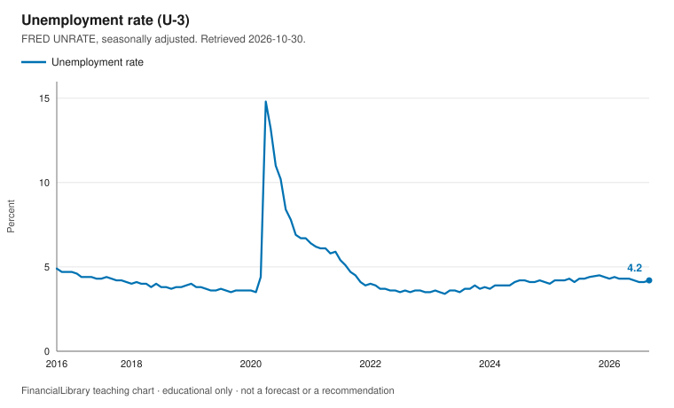
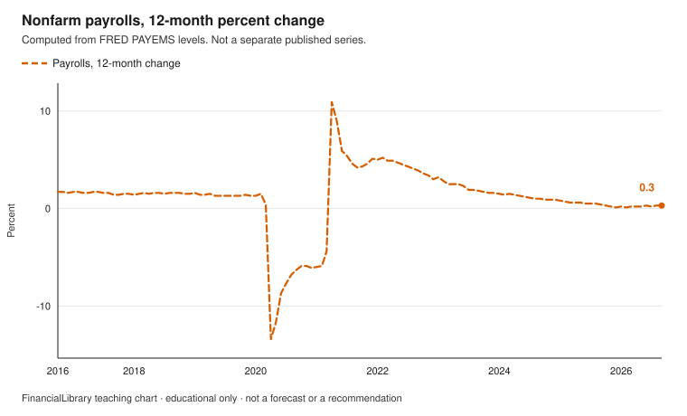
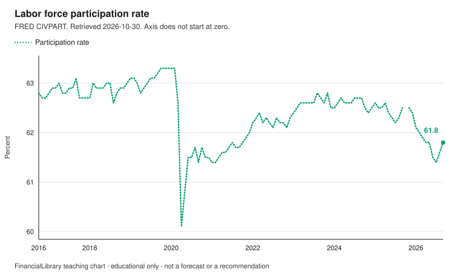

# Labor market

!!! warning "Educational only"
    This page is for financial literacy. It is **not** personalized advice,
    an offer to sell, or a recommendation to buy, sell, or hold any product.
    Rules differ by country; verify with official sources in your jurisdiction.

Three US labor-market series answer three different questions: the share of the labor force that
is unemployed, the count of jobs on payrolls, and the share of the population in the labor
force. This module does not turn any of them into a personal money decision.

## Learning objectives

1. Say what the unemployment rate, nonfarm payroll employment, and the participation rate each
   count.
2. Compute a 12-month percent change in payrolls from two levels, and keep the unit (thousands
   of persons) attached to the level.
3. Name one thing the unemployment rate does not count.

## The picture

{.teaching-figure}

Caption: FRED `UNRATE`, the seasonally adjusted U-3 unemployment rate. Window 2016-10-01 through
2026-10-30. The vertical axis includes zero.

PNG of the same chart: [download](figures/labor-unemployment.png).

{.teaching-figure}

Caption: Twelve-month percent change in FRED `PAYEMS` (total nonfarm payrolls, seasonally
adjusted, thousands of persons). Computed in this library from the levels. It is not a separate
published series. The vertical axis includes zero.

PNG of the same chart: [download](figures/labor-payroll-change.png).

{.teaching-figure}

Caption: FRED `CIVPART`, the labor force participation rate. The vertical axis does not start at
zero, so a small move looks larger than it would on an axis from zero. Read the labels.

PNG of the same chart: [download](figures/labor-participation.png).

## Explainer

`UNRATE` is the seasonally adjusted unemployment rate: unemployed people as a percent of the
labor force. People who are not looking for work are outside that rate. `PAYEMS` counts jobs on
nonfarm payrolls, in thousands of persons, not a percent. `CIVPART` is the share of the civilian
noninstitutional population that is in the labor force.

In this window, the unemployment rate ranges from 3.4% on 2023-04-01 to 14.8% on 2020-04-01.

In this window, the participation rate ranges from 60.1% on 2020-04-01 to 63.3% on 2020-02-01.

On 2026-09-01, payroll employment is 159044 thousand persons, against 158548 thousand on
2025-09-01. The level is higher by 496 thousand persons. The computed 12-month percent change is
0.3%.

The latest unemployment rate in the window is 4.2% on 2026-09-01. The latest participation rate
is 61.8% on 2026-09-01.

## Discussion questions

1. Describe one way the unemployment rate could fall even if payroll employment did not rise.
2. PAYEMS counts jobs on payrolls. Whose work might that survey miss?
3. If the question is whether work feels harder to find, which chart would you open, and what
   would it still not tell you?

## Exercise

Read the unemployment rate for 2026-09-01. Then subtract payroll employment on 2025-09-01 from
payroll employment on 2026-09-01. Keep the unit. Is the later level higher or lower?

## Answer key

Discussion questions stay open. This key answers the exercise only.

<details markdown="1">
<summary>Show the answer key</summary>

The unemployment rate on 2026-09-01 is 4.2 percent (`UNRATE`). Payroll employment is 159044
thousand persons on 2026-09-01 and 158548 thousand on 2025-09-01 (`PAYEMS`). The difference is
496 thousand persons, so the later level is higher. The computed percent change is 0.3 percent.
A higher payroll count is a description of this series, not advice about a job or a product.

</details>

## Sources and citations

Retrieved 2026-10-30. `PAYEMS` is published in thousands of persons.

| Series | ID | Observation | Value | Series page |
| --- | --- | --- | --- | --- |
| Unemployment rate | UNRATE | 2026-09-01 | 4.2% | [FRED](https://fred.stlouisfed.org/series/UNRATE) |
| Nonfarm payrolls | PAYEMS | 2026-09-01 | 159044 thousand | [FRED](https://fred.stlouisfed.org/series/PAYEMS) |
| Nonfarm payrolls, one year earlier | PAYEMS | 2025-09-01 | 158548 thousand | [FRED](https://fred.stlouisfed.org/series/PAYEMS) |
| Payroll change, computed here | PAYEMS | 2026-09-01 | 496 thousand (0.3%) | Not a separate FRED series |
| Labor force participation | CIVPART | 2026-09-01 | 61.8% | [FRED](https://fred.stlouisfed.org/series/CIVPART) |

```text
https://fred.stlouisfed.org/graph/fredgraph.csv?id=UNRATE
https://fred.stlouisfed.org/graph/fredgraph.csv?id=PAYEMS
https://fred.stlouisfed.org/graph/fredgraph.csv?id=CIVPART
```

## Related

- [Teaching portfolio](index.md)
- [Emergency savings](../emergency-savings.md)
- [Glossary](../../glossary.md)
