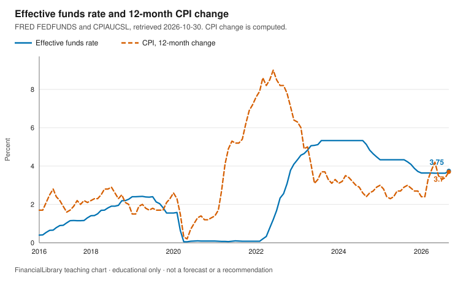
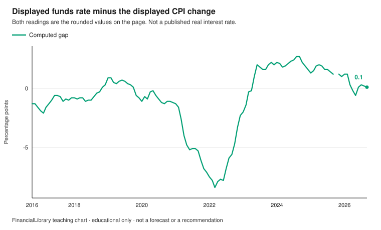

# Rates and inflation

!!! warning "Educational only"
    This page is for financial literacy. It is **not** personalized advice,
    an offer to sell, or a recommendation to buy, sell, or hold any product.
    Rules differ by country; verify with official sources in your jurisdiction.

This module shows two US readings that often get collapsed into the word rates: the effective
federal funds rate, and a 12-month percent change in consumer prices computed from the CPI
index. It does not say what a household should do with either number.

## Learning objectives

1. Distinguish the effective federal funds rate from a 12-month change in the CPI.
2. Compute that CPI change from two index levels, and say that the result is not itself a FRED
   percent series.
3. Explain why subtracting those two readings is a classroom comparison, not a published real
   interest rate and not a savings return.

## The picture

{.teaching-figure}

Caption: Solid blue is FRED `FEDFUNDS`, the monthly average effective federal funds rate. Dashed
vermillion is the 12-month percent change in `CPIAUCSL`, computed here from the index and
rounded half up to one decimal. Window: 2016-10-01 through 2026-10-30. The vertical axis
includes zero. CPIAUCSL has no observation on 2025-10-01 in this FRED snapshot, so the line
breaks instead of bridging that month. This page does not state a cause.

PNG of the same chart: [download](figures/rates-policy-and-inflation.png).

{.teaching-figure}

Caption: Each point is the displayed funds rate (two decimals) minus the displayed CPI change
(one decimal). The difference is then rounded half up to one decimal. Computed in this library.
It is not a separate published series and not a real interest rate.

PNG of the same chart: [download](figures/rates-computed-gap.png).

## Explainer

`FEDFUNDS` is the monthly average effective federal funds rate in the market. It is not the
target range the Federal Open Market Committee sets. That range is a different pair of FRED
series, `DFEDTARL` and `DFEDTARU`. This module does not plot them and does not quote them.

`CPIAUCSL` is the seasonally adjusted Consumer Price Index for all urban consumers, an index,
not a percent. The percent on the chart is
`(this month's index / the same month a year earlier - 1) × 100`, rounded half up to one decimal
place. If that prior month is missing, the point is skipped. A nearby month is not used as a
stand-in.

The latest funds-rate observation in the snapshot on or before 2026-10-30 is 3.75% on
2026-09-01. The CPI index on 2026-09-01 is 336.298, against 324.245 on 2025-09-01. That ratio,
rounded half up, is a 3.7% change. The gap chart uses those displayed readings: 3.75 minus 3.7
is 0.05, which rounds half up to 0.1 percentage points. That result is positive.

In this window, the effective funds rate ranges from 0.05% (from 2020-04-01 to 2020-05-01) to
5.33% (from 2023-08-01 to 2024-08-01).

In this window, the computed gap ranges from -8.4 percentage points (on 2022-03-01) to 2.7
percentage points (from 2024-08-01 to 2024-09-01).

A household savings rate can sit far from the funds rate because of the product, the bank, fees,
and insurance limits. This page does not collect those rates and does not suggest chasing the
gap. For the literacy framing, use
[Inflation and capital preservation](../inflation-capital-preservation.md).

## Discussion questions

1. The funds rate and the CPI change are both drawn as percents. What is each one actually
   measuring?
2. Why might a savings-account rate and the federal funds rate differ, without treating the
   difference as something to act on?
3. The chart ends at the latest month in the snapshot. What would you open before quoting the
   endpoint next month?

## Exercise

Using the readings printed for 2026-09-01, subtract the 12-month CPI change (3.7%, one decimal)
from the effective federal funds rate (3.75%, two decimals). Round that difference half up to
one decimal place. Say whether the result is positive or negative. Also name the two CPI index
levels behind the change.

## Answer key

Discussion questions stay open. This key answers the exercise only.

<details markdown="1">
<summary>Show the answer key</summary>

The displayed effective federal funds rate on 2026-09-01 is 3.75 percent (`FEDFUNDS`). The CPI
index is 336.298 on 2026-09-01 and 324.245 on 2025-09-01 (`CPIAUCSL`). The displayed 12-month
change is 3.7 percent. 3.75 minus 3.7 is 0.05, which rounds half up to 0.1 percentage points.
The result is positive. The gap compares two readings. It is not a published real rate and not a
return.

</details>

## Sources and citations

Retrieved 2026-10-30. Observations after that date are ignored. Request URLs are also in
`data/teaching/snapshots/manifest.json`. Terms: [data terms](index.md#data-terms).

| Series | ID | Observation | Value | Series page |
| --- | --- | --- | --- | --- |
| Effective federal funds rate | FEDFUNDS | 2026-09-01 | 3.75% | [FRED](https://fred.stlouisfed.org/series/FEDFUNDS) |
| CPI index, seasonally adjusted | CPIAUCSL | 2026-09-01 | 336.298 | [FRED](https://fred.stlouisfed.org/series/CPIAUCSL) |
| CPI index, one year earlier | CPIAUCSL | 2025-09-01 | 324.245 | [FRED](https://fred.stlouisfed.org/series/CPIAUCSL) |
| 12-month CPI change, rounded half up | CPIAUCSL | 2026-09-01 | 3.7% | Computed here, not a separate FRED series |
| Displayed funds rate minus displayed CPI change | FEDFUNDS and CPIAUCSL | 2026-09-01 | 0.1 pp | Not a separate FRED series |

```text
https://fred.stlouisfed.org/graph/fredgraph.csv?id=FEDFUNDS
https://fred.stlouisfed.org/graph/fredgraph.csv?id=CPIAUCSL
```

## Related

- [Teaching portfolio](index.md)
- [Inflation and capital preservation](../inflation-capital-preservation.md)
- [Glossary: inflation](../../glossary.md#inflation)
- [Glossary: capital preservation](../../glossary.md#capital-preservation)
- [Where to check official figures](../../about/where-to-check.md)
