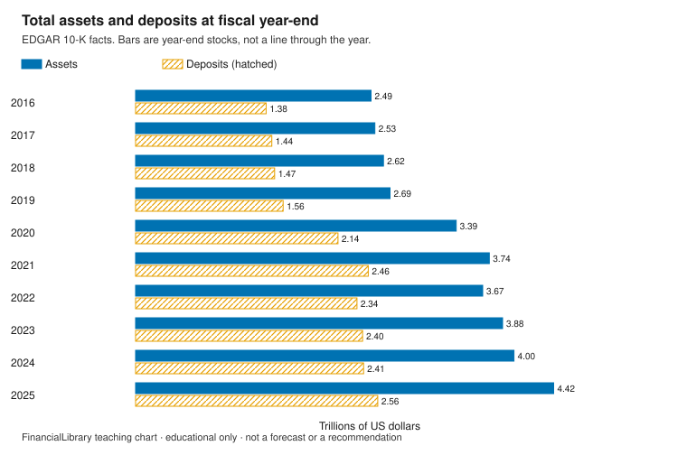
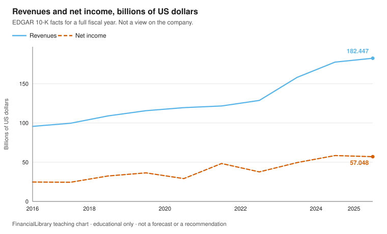

# Reading a 10-K

!!! warning "Educational only"
    This page is for financial literacy. It is **not** personalized advice,
    an offer to sell, or a recommendation to buy, sell, or hold any product.
    Rules differ by country; verify with official sources in your jurisdiction.

A Form 10-K is a company's annual report filed with the US Securities and Exchange Commission.
This module reads four tagged lines from one public filing, JPMorgan Chase & Co. (EDGAR name
JPMORGAN CHASE & CO, CIK 0000019617). The company is here because the filing is public and this
library already uses it in the educator filing watch. The page is not an assessment of the
company and not a recommendation to buy, sell, or hold its securities.

## Learning objectives

1. Open a 10-K from its EDGAR accession number and primary document.
2. Separate balance-sheet amounts (assets, deposits) from full-year flows (revenues, net
   income).
3. Explain why a deposit total in a 10-K is not an insured balance.

## The picture

{.teaching-figure}

Caption: Grouped bars for each fiscal year ending 31 December. The bars are not joined. Each bar
is the current-year column of that year's 10-K: `form` is `10-K`, `fp` is `FY`, and `fy` matches
the year of `end`. Comparative columns repeated in a later 10-K are excluded. Amounts are the
tagged integer divided by one trillion, rounded half up to two decimals.

PNG of the same chart: [download](figures/filing-assets-deposits.png).

{.teaching-figure}

Caption: Revenues (`Revenues`) and net income (`NetIncomeLoss`) for the full fiscal year, as
separate bars. Same selection rule. Amounts are the tagged integer divided by one billion,
rounded half up to two decimals.

PNG of the same chart: [download](figures/filing-revenue-income.png).

## Explainer

Assets and deposits are stocks: amounts at a period end. Revenues and net income are flows:
amounts over a fiscal year. Deposits here are an accounting total for the consolidated company.
Deposit insurance is a separate legal limit. This snapshot does not include that limit, so this
page does not state one. Read the current limit on the FDIC's own page, and write down the date
you read it.

For the fiscal year ended 2025-12-31, filed 2026-02-13, accession `0001628280-26-008131`: assets
$4.42 trillion, deposits $2.56 trillion, revenues $182.45 billion, and net income $57.05
billion. Those are the tagged US dollar amounts in trillions, rounded half up. In billions, to
two decimals, deposits are $2,559.32B and assets are $4,424.90B. Dividing those billion amounts
gives 57.8 percent, the same one-decimal result as the tagged integers.

The same year can show a different number in a later 10-K when the company presents comparative
columns or revises a figure. The charts keep the number from the 10-K whose fiscal-year tag
matches that year.

## Discussion questions

1. Why is a deposit line on a bank's balance sheet not the amount one depositor is insured for?
2. Why might the number for an earlier year change when you open a later 10-K?
3. What would you want to see besides these four lines before describing the business in your
   own words?

## Exercise

Using the billion amounts for the fiscal year ended 2025-12-31 ($2,559.32B of deposits and
$4,424.90B of assets), divide deposits by assets and give the result as a percent to one decimal
place. Then name the filing date and the accession number.

## Answer key

Discussion questions stay open. This key answers the exercise only.

<details markdown="1">
<summary>Show the answer key</summary>

Deposits are $2,559.32B and assets are $4,424.90B. Dividing those amounts gives 57.8 percent.
The 10-K was filed on 2026-02-13, accession `0001628280-26-008131`, for the period ended
2025-12-31. Primary document:
[10-K on EDGAR](https://www.sec.gov/Archives/edgar/data/19617/000162828026008131/jpm-20251231.htm).
The ratio describes two lines in a filing. It is not a capital ratio, not an insurance
calculation, and not a recommendation.

</details>

## Sources and citations

Retrieved 2026-10-30. Facts are copied from the SEC companyfacts JSON. The full payload is not
stored; `data/teaching/snapshots/manifest.json` records its SHA-256. Selection rule: `form`
`10-K`, `fp` `FY`, `fy` equal to the year of `end`; duration facts must also start in that year.

| Line | US-GAAP concept | Period end | Filed | Tagged USD | Rounded reading |
| --- | --- | --- | --- | --- | --- |
| Assets | Assets | 2025-12-31 | 2026-02-13 | 4424900000000 | $4.42 trillion |
| Deposits | Deposits | 2025-12-31 | 2026-02-13 | 2559320000000 | $2.56 trillion |
| Revenues | Revenues | 2025-12-31 | 2026-02-13 | 182447000000 | $182.45 billion |
| Net income | NetIncomeLoss | 2025-12-31 | 2026-02-13 | 57048000000 | $57.05 billion |
| Deposits / assets from the rounded readings | Deposits and Assets | 2025-12-31 | 2026-02-13 | see tagged amounts | 57.8% |

Latest 10-K on or before 2026-10-30: filed 2026-02-13, accession `0001628280-26-008131`, primary
document `jpm-20251231.htm`.

```text
https://data.sec.gov/api/xbrl/companyfacts/CIK0000019617.json
https://data.sec.gov/submissions/CIK0000019617.json
https://www.sec.gov/Archives/edgar/data/19617/000162828026008131/jpm-20251231.htm
```

## Related

- [Teaching portfolio](index.md)
- [Educator examples](../educator-examples.md)
- [FDIC savings](../../vehicles/us/fdic-savings.md)
- [Glossary: deposit insurance](../../glossary.md#deposit-insurance)
- [FDIC deposit insurance](https://www.fdic.gov/resources/deposit-insurance/)
