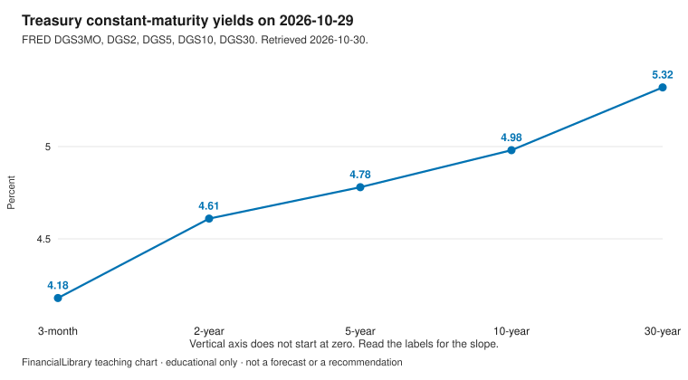
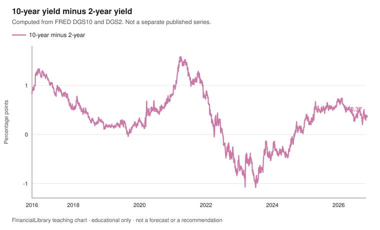

# Yield curve

!!! warning "Educational only"
    This page is for financial literacy. It is **not** personalized advice,
    an offer to sell, or a recommendation to buy, sell, or hold any product.
    Rules differ by country; verify with official sources in your jurisdiction.

A yield curve plots interest rates against maturity on one date. This module uses US Treasury
constant-maturity yields from FRED. It does not say whether to lend, borrow, or buy a bond.

## Learning objectives

1. Read a yield curve as yields at several maturities on a single date.
2. Compute the 10-year minus 2-year spread and state the sign.
3. Keep Treasury yields distinct from a household savings rate.

## The picture

{.teaching-figure}

Caption: One date, 2026-10-29, the latest date on or before 2026-10-30 with a value for every
maturity plotted. The vertical axis does not start at zero, so read the labels. The slope is the
difference between labels, not the steepness against a zero baseline.

PNG of the same chart: [download](figures/yield-curve-snapshot.png).

{.teaching-figure}

Caption: Each point is the 10-year constant-maturity yield minus the 2-year yield that same day,
in percentage points. Computed in this library from `DGS10` and `DGS2`. It is not a separate
published series. The spread is negative on 544 of 2518 plotted dates. The vertical axis
includes zero.

PNG of the same chart: [download](figures/yield-spread.png).

## Explainer

FRED's `DGS` series are constant-maturity Treasury yields, in percent, for business days. A
missing day in the file (often a period instead of a number) is skipped. This chart does not
fill the gap.

On 2026-10-29, the 10-year yield is above the 2-year yield, so the curve slopes upward on this
date. The computed spread, 10-year minus 2-year, is 0.37 percentage points. A negative spread
means the 2-year yield is higher than the 10-year yield that day. People often call that an
inversion. The word names the arithmetic. It is not a forecast on this page.

The five yields on 2026-10-29 are 3-month 4.18%, 2-year 4.61%, 5-year 4.78%, 10-year 4.98%,
30-year 5.32%.

These are not the rate on a savings account, a certificate of deposit, or a loan. Comparing them
to a household product needs the product's own terms, read from the provider or a regulator,
which this snapshot does not include.

## Discussion questions

1. On the snapshot date, which maturity has the highest yield and which has the lowest?
2. What does a negative 10-year-minus-2-year spread mean as arithmetic, before any story about
   the future?
3. What else would you need before comparing a Treasury yield with a savings-account rate?

## Exercise

On 2026-10-29, subtract the 2-year yield from the 10-year yield. Give the difference to two
decimal places. Does the 10-year yield sit above or below the 2-year yield?

## Answer key

Discussion questions stay open. This key answers the exercise only.

<details markdown="1">
<summary>Show the answer key</summary>

On 2026-10-29, `DGS10` is 4.98% and `DGS2` is 4.61%. 4.98 minus 4.61 is 0.37 percentage points.
The 10-year yield is above the 2-year yield. That is a description of this date, not a bond
recommendation.

</details>

## Sources and citations

Retrieved 2026-10-30. The curve uses 2026-10-29, the latest common observation.

| Series | ID | Observation | Value | Series page |
| --- | --- | --- | --- | --- |
| 3-month Treasury constant maturity | DGS3MO | 2026-10-29 | 4.18% | [FRED](https://fred.stlouisfed.org/series/DGS3MO) |
| 2-year Treasury constant maturity | DGS2 | 2026-10-29 | 4.61% | [FRED](https://fred.stlouisfed.org/series/DGS2) |
| 5-year Treasury constant maturity | DGS5 | 2026-10-29 | 4.78% | [FRED](https://fred.stlouisfed.org/series/DGS5) |
| 10-year Treasury constant maturity | DGS10 | 2026-10-29 | 4.98% | [FRED](https://fred.stlouisfed.org/series/DGS10) |
| 30-year Treasury constant maturity | DGS30 | 2026-10-29 | 5.32% | [FRED](https://fred.stlouisfed.org/series/DGS30) |
| 10-year minus 2-year, computed here | DGS10 minus DGS2 | 2026-10-29 | 0.37 pp | Not a separate FRED series |

```text
https://fred.stlouisfed.org/graph/fredgraph.csv?id=DGS3MO
https://fred.stlouisfed.org/graph/fredgraph.csv?id=DGS2
https://fred.stlouisfed.org/graph/fredgraph.csv?id=DGS5
https://fred.stlouisfed.org/graph/fredgraph.csv?id=DGS10
https://fred.stlouisfed.org/graph/fredgraph.csv?id=DGS30
```

## Related

- [Teaching portfolio](index.md)
- [Rates and inflation](rates-and-inflation.md)
- [TreasuryDirect](../../vehicles/us/treasurydirect.md)
- [Glossary](../../glossary.md)
